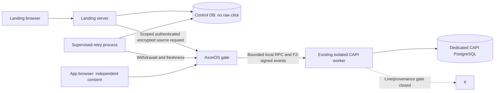

# AxonOS first-party handoff v2 contract

Revision: `2.0.0-candidate.2`. Scope: isolated synthetic engineering specification. Status is recorded in `manifest.json`; no artifact is operator approval to implement, stage, deploy, provision secrets, process real clicks or enable X delivery.

The operator provisionally selected Policy B (global worker-verified 30-second maximum freshness lease, 10-second renewal attempts) and central worker custody after explicit landing consent, for isolated synthetic development only. All other values are documented candidate engineering constants, not legal/production approval. CAPI remains off, Stripe CARD remains disabled, and live delivery/click provenance gates remain intact.

## Starting repositories

| Repository | Branch | Starting SHA |
|---|---|---|
| `/home/cluadmin/worktrees/axonos-x-capi-reconciliation` | `codex/x-capi-reconciliation` | `004aba17456f3a107ee20f8d3f635ca638f29b54` |
| `/home/cluadmin/axonos-io-landing-page` | `main` | `c219dac3a0568ced7df99099f36c13e213921893` |
| `/home/cluadmin/axondao-io-gitops-main` | `main` | `270899e7e2f0d5056f575da93e0d921b016cccfd` |

All three were clean before authoring. Backend ancestry is ddb7c99 -> 4bb0afc -> f3589c1 -> 004aba1. Local source does not establish production state. Financial migrations 006/007 and all three security milestones remain preserved.

## Read order and normative artifacts

1. `protocol.json` fixes versions, origins, operations and limits.
2. `openapi.yaml` and `schemas/` define closed wire shapes; parser and semantic requirements also apply.
3. `cryptographic-formats.md` fixes exact bytes and v4/F2 compatibility.
4. `browser-contract.md` defines pre-render capture, consent and browser ownership.
5. `database-contract.md`, `state-transitions.csv` and `consent-withdrawal-ordering.md` define durable transitions and privacy ordering.
6. `errors.csv`, `configuration-ownership.yaml` and `migration-rollback.md` define failure and operational boundaries.
7. `fixtures/`, `vectors/`, `test-matrix.csv` and `validation-report.md` define synthetic evidence and its limitations.
8. `manifest.json` records hashes, decisions, baselines and review evidence.

Artifacts are one contract. If they disagree, implementation stops pending correction; no file silently overrides another. JSON Schema describes value shapes. It cannot enforce duplicate-key rejection, MACs, cookie provenance, request byte canonicality, temporal relations, row locks or wallet authority. Those normative checks are specified in companion documents and fixtures.

No broker, landing raw-click store, browser JWS or PKCE is introduced. Gate has no CAPI DB credential. Worker gains no network egress. Handoff failure never causes payment rebroadcast, credit duplication, wallet credential disclosure or session-allocation retry.

## Consistency decisions resolved in this revision

- Initial observation uses a same-process adapter before Next sees the original request. Only a sanitized target and receipt reach SSR/RSC; browser candidate remains volatile. Actual Next standalone integration is an implementation acceptance requirement, not claimed verified.
- Canonical JSON is a restricted ASCII/integer format; commitment hashes are lowercase hex and MACs are canonical unpadded base64url. Request/response/receipt purposes are distinct, with final LF framing.
- H is hash-only. A committed begin retry returns RESULT_UNAVAILABLE. No automatic remint, unbounded new attempts or reconstructed secret. Valid callback recovery returns exactly the retained encrypted context.
- Cookie creation loss uses the same principle: existing confirmed cookie returns metadata; missing committed hash-only cookie is not silently replaced. Provisional unconfirmed rows expire without raw data.
- Imported contexts require server-captured A ownership in every positive v2 F2 envelope. Bind normalization cannot drop it. Missing mapping/version/owner suppresses attribution; legacy privacy closure remains available.
- V4 ticket version and 14-field shape remain unchanged; its seconds are not new wire milliseconds. Import records are authoritative for exact millisecond cutoffs and owner mapping.
- Binding timestamps are conservative decision boundaries, not claims about physical commit time. Non-wallet event timestamps must be strictly later; no historical event creation or timestamp rewriting.
- New CAPI schema target is 5; migration filename008 does not mean schema version8 and does not depend on financial006/007.
- Worker restart invalidates leases; a restored empty queue is not readiness. Recovery requires an external generation/epoch record and retirement/quarantine.
- The synthetic clock profile and remaining TTL/capacity values preserve prior candidate bounds; they are not real-traffic approval.

## Browser and service operations

Every path/method/origin is enumerated in `protocol.json` and OpenAPI. Browser forms have exactly `v` and `handoff`. No redirect/callback/origin parameter is accepted. The only destination enum is `desktop`, mapped to fixed clean `/vnc.html`. No capability is put in a URL. All same-origin handoff JSON uses exact Origin plus `X-AxonOS-Handoff: 2`; no cross-origin CORS permission. Cookies and side effects are purpose-specific, never wallet authentication.

All successful source operations use HTTP200. Browser operations use200, except a locally durable, unacknowledged landing withdrawal uses202. Creation does not require201. Error codes/statuses/retry flags come from `errors.csv`. HTML bridges return corresponding bounded safe HTML, not reflected JSON or exception bodies. Existing financial/auth APIs are not redefined by this OpenAPI.

Off mode rejects positive capture/prepare/begin/authorize/redeem/ingestion with ATTRIBUTION_DISABLED and creates no production-eligible work. Privacy closure and pending withdrawal maintenance remain available. Positive synthetic tests may use isolated dry_run, generated test keys and blocked external transport. No dry_run fixture may be imported into real state or change real mode.

## Prerequisites and unresolved approvals

No engineering OPEN_DECISION is intentionally hidden. `manifest.json` separately lists future legal/privacy, infrastructure and deployment approvals. Artifact readiness means the candidate is coherent and reviewable; it does not mean those approvals exist.

Required before any real handoff traffic: approved consent/custody/retention notice; durable control DB and supervised retries; authenticated encryption over every internal network hop; effective isolation and direct-backend restrictions; app nginx access/error privacy; exact Umami request Cookie/Authorization and response Set-Cookie removal; immutable images; bounded clock assurance; encrypted database/backups; external recovery anchor and runbook. Existing Envoy query-free logging and Umami click filtering are reusable committed evidence, not proof of the new end-to-end path. CNI policy enforcement and runtime configuration remain unverified.

## Exclusive implementation ownership and dependency order

Session A owns backend worker/schema/local RPC, Flask/Websockify parity, immutable request-owner capture and v2 F2 proof, app browser bridge/noVNC integration and backend tests. Future files include axonos_gate/x_capi.py, x_capi_worker.py, gate_server.py, websockify_gate.py, novnc-theme/app/x-attribution.js, relevant tests and proposed CAPI migration008. No financial changes or production actions.

Session B owns landing Next.js capture/consent/pre-render adapter, privacy-control database, supervised withdrawal/lease process, source client, all app-entry controls, analytics ordering, landing/browser tests and build packaging necessary for the same-process adapter. It edits no backend or GitOps files.

Session C remains read-only planning initially. Later separately approved work may provide TLS/isolation, safe nginx logging, exact Umami header stripping, durable store/secret references and immutable rollout. GitOps publication may deploy automatically; publishing is not authorized by this contract.

Order: operator reviews artifacts -> independent review closes findings -> explicit contract freeze/revision hash -> separate implementation authorization -> A shared backend contracts/fixtures and isolated schema tests -> B client/storage/browser work against the same bytes -> integrated disposable tests -> C reviewed infrastructure proposal -> separately approved synthetic staging. Legal/real-click/live-delivery decisions remain separate at every step.

## Later byte-identical transfer to landing (NOT authorized now)

After explicit approval, verify both source/destination Git baselines and stop on unexpected state. Source is the entire approved `contracts/x-capi-handoff/v2/` directory in the backend worktree. Destination is the same relative directory in the landing worktree. Require the destination to be absent; do not overwrite a preexisting contract silently. Copy all regular files, including manifest, without regeneration, line-ending conversion, substitutions or secrets. Do not copy symlinks or executable files.

Use a local Python standard-library copy (`shutil.copytree(source, destination)`) only after the above authorization. Verify destination file set equals source file set; compare manifest bytes; for each manifest.files entry compute SHA256 of bytes at both paths and compare to the recorded digest. Compute and compare SHA256(manifest.json) externally because manifest does not hash itself. Fail the copy review if any extra/missing file, byte difference or digest mismatch exists. No landing copy occurs in Phase2A.

Do not independently edit a vendored contract. A semantic change requires a new candidate revision, updated fixtures/hashes/review, and a coordinated byte-identical recopy after approval.
